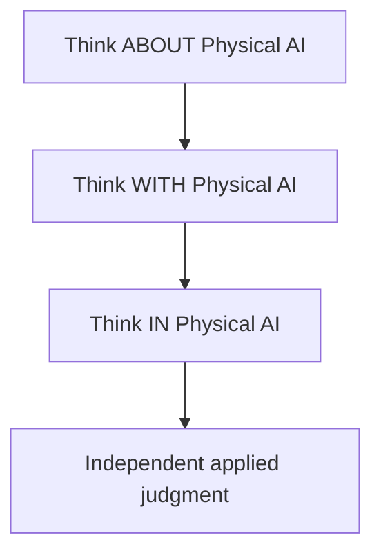

# Thinking in Physical AI

### From Machine Intelligence to Meaningful Physical Work

**Course shell v0.1.0 · Curriculum outlined · Lessons and laboratories under development**

[Start learning](START-HERE.md) · [Syllabus](SYLLABUS.md) · [Detailed outline](COURSE-OUTLINE.md) · [Development roadmap](ROADMAP.md)

## About the course

Artificial intelligence is moving from digital information processing into systems that sense, interpret and act in the physical world. These systems must contend with imperfect observations, gravity, contact, time, limited energy, human interaction and potentially irreversible consequences.

**Thinking in Physical AI** develops the mental models, investigative practices and judgment needed to understand, work with and responsibly design intelligent physical systems. It is not a robot-programming bootcamp or a condensed product-management textbook. It integrates AI, robotics, systems thinking, human factors, experimentation, product value, economics and governance through a progression from understanding to application to independent reasoning.

The central idea: a machine's capability is not proof of dependable work, permission to act or sustainable value. Learn to reason about the complete operated system—machine, intelligence, environment, people, workflow, service and economics—and to decide what should be done, under which conditions, with what evidence and with whose responsibility.

## The learning journey

| Stage | Purpose | Modules |
|---|---|---|
| [I — Think ABOUT Physical AI](course/01-think-about-physical-ai/README.md) | Understand intelligence in physical reality | 01–03 |
| [II — Think WITH Physical AI](course/02-think-with-physical-ai/README.md) | Apply, teach and collaborate with intelligent systems | 04–07 |
| [III — Think IN Physical AI](course/03-think-in-physical-ai/README.md) | Integrate evidence, responsibility, value and lifecycle judgment | 08–12 |

| Module | Thinking discipline | Central question | Status |
|---|---|---|---|
| 01 | [Physical Thinking](course/01-think-about-physical-ai/01-physical-thinking/README.md) | What changes when intelligence enters the physical world? | Planned |
| 02 | [Embodied Thinking](course/01-think-about-physical-ai/02-embodied-thinking/README.md) | How do body, intelligence and environment shape one another? | Planned |
| 03 | [Systems Thinking](course/01-think-about-physical-ai/03-systems-thinking/README.md) | How do perception, knowledge, planning, feedback and action work together? | Planned |
| 04 | [Work-Centric Thinking](course/02-think-with-physical-ai/04-work-centric-thinking/README.md) | What meaningful physical work should intelligent systems perform? | Planned |
| 05 | [Intelligence Thinking](course/02-think-with-physical-ai/05-intelligence-thinking/README.md) | What intelligence is needed, and how should we collaborate with it? | Planned |
| 06 | [Experiential Thinking](course/02-think-with-physical-ai/06-experiential-thinking/README.md) | How can machines acquire and improve physical skills through experience? | Planned |
| 07 | [Autonomy Thinking](course/02-think-with-physical-ai/07-autonomy-thinking/README.md) | How should humans and machines share control, authority and responsibility? | Planned |
| 08 | [Assurance Thinking](course/03-think-in-physical-ai/08-assurance-thinking/README.md) | What must be true before intelligent physical action is permitted? | Planned |
| 09 | [Evidence Thinking](course/03-think-in-physical-ai/09-evidence-thinking/README.md) | How do we establish that an intelligent physical system works? | Planned |
| 10 | [Product Thinking](course/03-think-in-physical-ai/10-product-thinking/README.md) | How does physical intelligence become a valuable product or service? | Planned |
| 11 | [Economic Thinking](course/03-think-in-physical-ai/11-economic-thinking/README.md) | Can intelligent physical systems create sustainable human and economic value? | Planned |
| 12 | [Evolutionary Thinking](course/03-think-in-physical-ai/12-evolutionary-thinking/README.md) | How do intelligent machines improve, scale and participate in larger systems? | Planned |

## Who is it for?
This course is built first for people who have to decide whether, where, and how an intelligent physical system should work in the real world, and who will be accountable for that decision.

Primary (Deciders): Product builders, founders, and operators who must choose what work to automate, what to deploy, under which conditions, with what evidence, and with whose responsibility.

Collaborators ( Builders alongside deciders): Engineers, designers, and AI and software professionals who design, build, evaluate, or operate intelligent physical systems and need a shared language for tradeoffs across body, intelligence, environment, people, workflow, service, and economics.

Also welcome: Explorers: Students, researchers, and business and policy leaders who want to understand how physical intelligence works, where it creates value, and where it should not be used, without first becoming robotics specialists.

This course is not for: People seeking a robotics engineering credential, a robot-programming bootcamp, or a condensed product-management textbook. It teaches judgment about physical systems, not how to build a robot from first principles.

How to choose your pathway: The core pathway requires no advanced mathematics, coding, or robot hardware. It uses cases, simulation walkthroughs, failure analyses, and decision exercises. Optional technical extensions add greater depth for learners who want it, for example in perception, learning, control, and evaluation, without changing what the core pathway requires.

## How to learn

The proposed self-paced or facilitated twelve-module course uses **Encounter → Predict → Understand → Experiment → Challenge → Explain → Decide → Reflect → Transfer**. Each module will contain a conceptual lesson, thinking studio, portfolio assignment and assessment. Start a personal project by Module 02; develop it throughout the course and defend an evidence-based decision in the capstone.

- [Thinking framework](framework/README.md) and [human reasoning loop](framework/reasoning-loop.md)
- [Thinking Portfolio](portfolio/README.md) and [capstone](capstone/README.md)
- [Case studies](case-studies/README.md) and [resources](resources/README.md)
- [Learning laboratories and planned supporting assets](labs/README.md)

## Publication status

This is a course architecture, not a completed course. Every module has an authored outline and intentionally labeled placeholders for full instructional content, executable laboratories, readings and assessments. No completed experiments, student results, credits, certifications or professional qualifications are claimed. Do not attempt uncontrolled physical machinery experiments.

See [ROADMAP.md](ROADMAP.md) for progress, [CONTRIBUTING.md](CONTRIBUTING.md) for editorial standards and [LICENSING.md](LICENSING.md) for the pending licensing decision.

## Inspiration and independence

This independent course is inspired by the author's Physical AI Primer for Product Builders draft and the experiential, personalized and reflective approach of Stanford CS193T, [Thinking with AI](https://web.stanford.edu/class/archive/cs/cs193t/cs193t.1272/), taught by Cynthia Bailey. It is not affiliated with, endorsed by or offered by Stanford University. See [references and attribution](resources/references.md).
