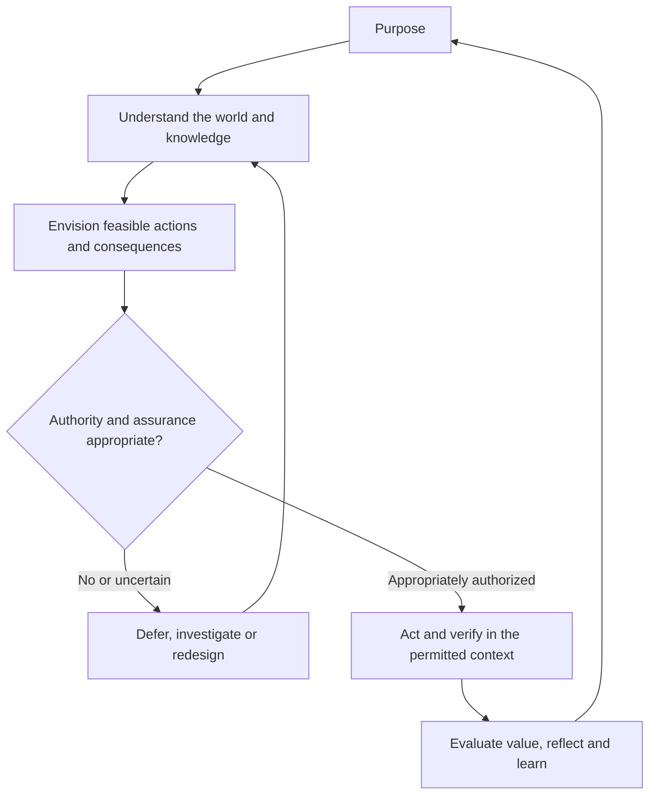

# The human reasoning loop

[Framework](README.md) · [Course home](../README.md)

## Definition

Thinking in Physical AI is the practice of reasoning about intelligence, embodiment, physical interaction, consequences and human purpose in order to investigate, design, evaluate and responsibly decide about intelligent physical systems.

## Ten questions to carry into any situation

| Dimension | Question |
|---|---|
| Purpose | What meaningful physical outcome matters, and to whom? |
| World | What is actually happening in the environment? |
| Knowledge | What does the machine observe or infer, and what is uncertain? |
| Embodiment | What physical capabilities and limits does it have? |
| Possibility | Which actions are physically feasible? |
| Prediction | What could happen if it takes one action rather than another? |
| Authority | Which actions are permitted, by whom, under what evidence and conditions? |
| Verification | Did the required physical effect or accepted work actually occur? |
| Value | Was the outcome beneficial, worthwhile and sustainable? |
| Adaptation | What should change based on the evidence? |

The diagram is a human reasoning aid, not a control algorithm, safety controller or permission to act. In course labs, action usually refers to a simulated or tabletop investigation. Physical operation requires appropriate independent authorization and controls.

## The machine loop (conceptual)

Sense → estimate/understand → decide/plan → act → observe/verify → correct. Longer-term learning can use accumulated evidence through controlled training and release. Not every intelligent physical system learns online, and not every action requires an AI model. The machine loop is different from human decisions about what to build, permit or deploy.
